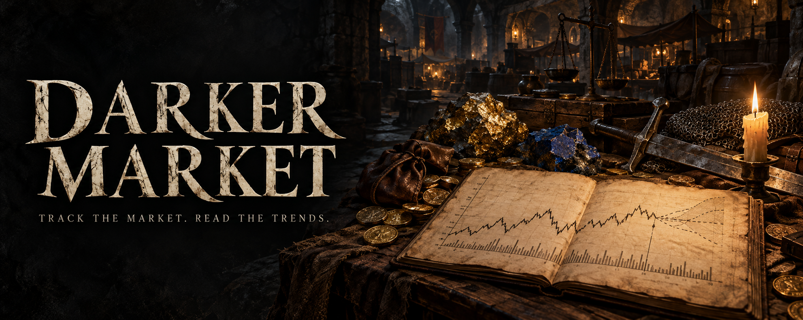
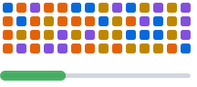

<p align="center"></p>

<p align="center">
  <a href="LICENSE"></a>
  
  
  <a href="https://afdian.com/a/felixcode"></a>
</p>

<p align="center">
  在自己电脑上追踪和预测 <b>Dark and Darker（暗黑地牢）</b>交易行价格<br />
  Track and forecast <b>Dark and Darker</b> marketplace prices on your own machine
</p>

<p align="center">
  <picture>
    <source media="(prefers-color-scheme: dark)" srcset="docs/assets/market-banner-dark.svg" />
    
  </picture>
</p>

<table>
  <tr>
    <td align="center" width="33%">
      <picture>
        <source media="(prefers-color-scheme: dark)" srcset="docs/assets/how-collect-dark.svg" />
        
      </picture>
      <br /><b>采集 · Collect</b><br />从 DarkerDB 采集挂单，存在本机<br /><sub>Listings from DarkerDB, kept on your machine</sub>
    </td>
    <td align="center" width="33%">
      <picture>
        <source media="(prefers-color-scheme: dark)" srcset="docs/assets/how-filter-dark.svg" />
        
      </picture>
      <br /><b>筛选 · Filter</b><br />装备按词条数值范围找挂单<br /><sub>Find gear by stat ranges</sub>
    </td>
    <td align="center" width="33%">
      <picture>
        <source media="(prefers-color-scheme: dark)" srcset="docs/assets/how-forecast-dark.svg" />
        
      </picture>
      <br /><b>预测 · Forecast</b><br />比基准更准才采用模型<br /><sub>A model is used only if it beats the baseline</sub>
    </td>
  </tr>
</table>

## 开始 · Start

```bash
./start.sh        # macOS / Linux
start.bat         # Windows：双击 / double-click
```

需要 Python 3.10+、Node.js 20+ 和一个免费的 [DarkerDB API key](https://darkerdb.com/dashboard/api-keys)。之后的所有设置都在程序界面里完成。<br />
<sub>Needs Python 3.10+, Node.js 20+ and a free DarkerDB API key. Everything else is set up inside the app.</sub>

📖 [使用指南](docs/GUIDE.zh.md) · [Guide](docs/GUIDE.en.md)

---

<sub>
☕ 喜欢的话可以在 <a href="https://afdian.com/a/felixcode">爱发电</a> 请作者喝一杯麦酒 · <a href="https://afdian.com/a/felixcode">Support on afdian</a><br />
© 2025-2026 StarryCoder · <a href="LICENSE">AGPL-3.0-or-later</a> · 与 IRONMACE 和 DarkerDB 无关联 · Not affiliated with IRONMACE or DarkerDB
</sub>
